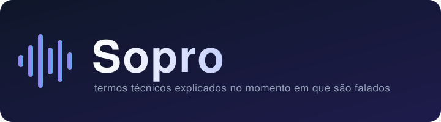
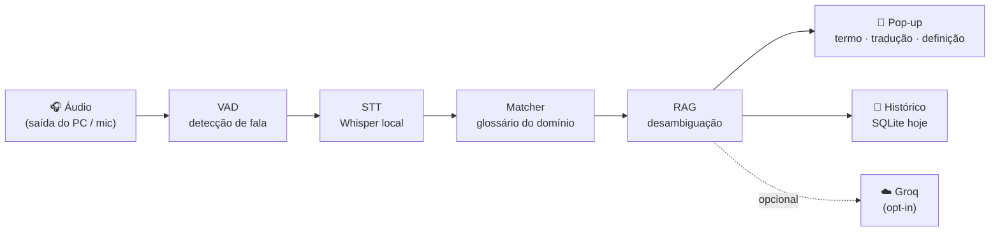
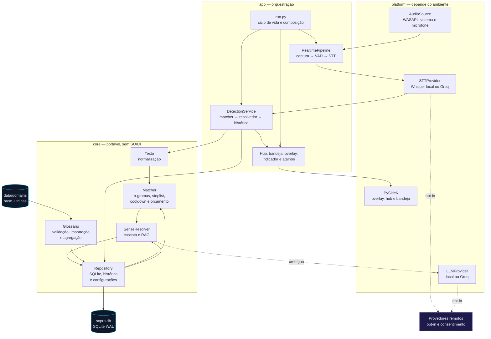
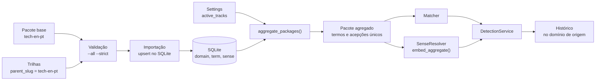

<div align="center">



# Sopro

**Um companheiro discreto que explica termos técnicos em inglês no exato momento em que eles são falados.**

[](#roadmap-em-5-fases)
[](CHANGELOG.md)
[](pyproject.toml)
[](#instalação-windows)
[](tests)
[](LICENSE)

[Visão geral](#-por-que-o-sopro) ·
[Como funciona](#-como-funciona) ·
[Arquitetura](#arquitetura) ·
[Stack](#-stack) ·
[Instalação](#-instalação-windows) ·
[Desenvolvimento](#-uso-a-partir-do-fonte) ·
[Roadmap](#-roadmap) ·
[Changelog](#-versões-e-changelog)

</div>

---

Você está numa aula, palestra ou call técnica em inglês e ouve *“fairness”* ou *“backlog”*
passar rápido. Parar para pesquisar quebra a atenção; a legenda automática traduz a frase, mas
não explica o termo nem escolhe o sentido certo para a área.

O **Sopro** escuta o áudio do seu computador (ou do microfone), detecta o termo quando ele é
falado e mostra um cartão curto com **termo, tradução e definição no contexto da área** — sem
interromper a aula e sem roubar o foco da janela.

> **Status:** protótipo funcional — Fases 0–4 concluídas. O pipeline completo
> (captura → VAD → transcrição → matcher → pop-up → histórico) roda de ponta a ponta, com
> instalador Windows, assistente de primeira execução, logs sem conteúdo de fala e gestão de
> glossários. A **Fase 5** (escala e portabilidade) está em andamento; a **Fase 6** (curadoria
> assistida) e a **Fase 7** (conta, dados em nuvem e backup) estão planejadas. **416 testes
> automatizados** passando.

## ✨ Por que o Sopro

- **Pop-up por termo, não legenda corrida** — um cartão temporário, sempre no topo, sem roubar
  o foco do Teams/Meet/Zoom.
- **Local primeiro** — captura, transcrição e matcher funcionam offline; a nuvem de IA
  (Groq) é opcional e só com aviso explícito. A Fase 7 planeja conta e dados em nuvem,
  mantendo cache offline.
- **A definição certa para a área** — recuperação semântica escolhe a acepção correta
  (ex.: *fairness* = “equidade” em IA, não “justiça” genérica).
- **Privacidade por padrão** — o áudio não é gravado nem enviado; hoje os dados ficam locais
  e, na Fase 7 planejada, vão apenas para a conta do usuário (Clerk/Neon/R2).
- **Somente free tier** — Whisper local, SQLite e, na Fase 7, Clerk/Neon/R2/Workers no plano
  gratuito.
- **Escalável por domínio** — glossários de tecnologia hoje; direito, saúde e finanças depois.

## 🔍 Como funciona



O LLM **não** processa toda frase: o caminho rápido é a busca no glossário local. RAG/LLM só
entram para resolver ambiguidade ou termos fora do glossário — o que mantém latência, CPU e
custo baixos. Na Fase 7 planejada, o histórico passa a ter a nuvem como fonte da verdade e o
SQLite vira cache/outbox offline.

## Arquitetura

O Sopro separa três camadas com uma regra rígida: **`core` não conhece sistema operacional,
Qt nem rede**. `platform` isola tudo que depende do ambiente; `app` compõe o pipeline e o
ciclo de vida. Áudio e transcrição são locais; hoje o histórico também é local. A Fase 7
planeja tornar a conta/nuvem a fonte da verdade dos dados do usuário, mantendo SQLite como
cache/outbox offline.



### Glossário e trilhas

O conhecimento é composto por uma **base** (`tech-en-pt`) e **trilhas** filhas
(`tech-programming-en-pt`, `tech-data-science-en-pt`, `tech-devops-en-pt`,
`tech-frontend-en-pt`, `tech-backend-en-pt`). O runtime importa os pacotes e monta um
**agregado em memória**: termos são deduplicados, acepções são mescladas e as da trilha ativa
têm prioridade. `active_tracks` vazio significa “todas as trilhas”.



Um pacote é apenas conteúdo: criar um glossário ou uma trilha **não exige mudar o núcleo**.
O formato, o validador e o passo a passo para contribuidores estão em
[CONTRIBUTING.md](CONTRIBUTING.md#criando-um-glossário-ou-uma-trilha); os fluxos completos,
em [`docs/roadmap/`](docs/roadmap/README.md) — em especial
[01-visao-geral.md](docs/roadmap/01-visao-geral.md),
[08-glossarios-e-trilhas.md](docs/roadmap/08-glossarios-e-trilhas.md) e
[09-construcao-de-glossario.md](docs/roadmap/09-construcao-de-glossario.md).

## 🖥️ Destaques da interface

- **Pop-ups** sem borda, sempre no topo e sem receber foco; superfície opaca de alto contraste,
  pausa no hover, ação “fixar” e **som opcional** ao exibir.
- **Indicador de estado** flutuante e arrastável, com pulso em tempo real pelo nível de áudio
  e estados `Carregando`, `Ouvindo`, `Analisando`, `Pausado` e `Erro`.
- **Hub** único com Status, Configurações, Glossários, Termos, Histórico e Demonstração.
- **Histórico** com busca, filtro por “aprendido” e período, além de exportação CSV/Markdown.
- **Bandeja** com atalhos para pausar, abrir o hub, revisar o histórico e ver um exemplo de
  pop-up — e um segundo atalho global para abrir o histórico diretamente.
- **Demonstração embutida** com termos reais do glossário ativo, sem áudio nem download de
  modelo.
- **Instância única** — reabrir o app traz o hub existente para frente em vez de duplicá-lo.

## 🧰 Stack

<table>
<tr>
<td valign="top" width="50%">

**Núcleo & aplicação**

| Camada | Tecnologia |
|---|---|
| Linguagem | Python 3.11+ (testado em 3.12) |
| Núcleo portável | `core/` puro (text, glossary, matcher, rag, llm, repo, config) |
| Orquestração | `app/` (run, realtime, single-instance, atalhos globais) |
| Banco de dados | SQLite (WAL, conexão por thread) |
| Empacotamento | PyInstaller (onedir) + Inno Setup |

</td>
<td valign="top" width="50%">

**Áudio, IA & interface**

| Camada | Tecnologia |
|---|---|
| Captura de áudio | WASAPI loopback + microfone (`PyAudioWPatch`) |
| Detecção de fala | VAD por energia (adaptável) · candidato: Silero |
| Transcrição | Whisper local (`faster-whisper`) · Groq (opcional) |
| Desambiguação | Embeddings (`sentence-transformers`, opcional) / embedder offline |
| Interface | PySide6 (overlay, bandeja, indicador, hub) |

</td>
</tr>
</table>

Detalhes de licenças, versões e free tier ficam em [docs/06-referencias.md](docs/06-referencias.md).

## 📦 Instalação (Windows)

Requisitos: **Windows 10 (build 1809+) ou Windows 11, 64-bit**; CPU com AVX2 recomendada.

1. Baixe `Sopro-Setup-x.y.z.exe` na página de [Releases](../../releases).
2. Execute o instalador (per-user, **não** exige administrador).
3. Na primeira execução, aceite o aviso de consentimento (LGPD) e escolha domínio, idioma de
   saída e fontes de áudio. O modelo de STT é baixado na hora, com progresso no indicador e na
   bandeja.

A versão portátil (`Sopro-x.y.z-portable.zip`) dispensa instalação: extraia e execute
`Sopro/Sopro.exe`. O modo demonstração (`Sopro.exe --demo`) funciona sem áudio e sem modelos.

> Ainda não há release pública marcada; o instalador já é gerado localmente e pelo CI. Os
> artefatos seguem o versionamento descrito em [Versões e changelog](#-versões-e-changelog).

## 🛠️ Uso a partir do fonte

Requisitos: Python 3.11+.

```bash
# criar e ativar o ambiente virtual
python -m venv .venv
. .venv/Scripts/activate        # Windows (Git Bash)
# source .venv/bin/activate     # Linux/macOS

# instalar em modo editável com dependências de desenvolvimento
python -m pip install -e ".[dev]"

# extras opcionais
python -m pip install -e ".[stt]"     # STT local (modelos de ~75–460 MB)
python -m pip install -e ".[audio]"   # captura WASAPI no Windows
python -m pip install -e ".[ui]"      # overlay, bandeja, indicador e hub (PySide6)
python -m pip install -e ".[rag]"     # embeddings reais (sem ele, usa o embedder offline)

# rodar o app (precisa de 'ui' e, para áudio real, de 'audio' + 'stt')
python -m sopro

# demonstração: pipeline + UI sem microfone e sem baixar modelos
python -m sopro --demo

# sonda de captura: mede o nível por fonte sem gravar em disco (10 s)
sopro-capture-probe --seconds 10

# testes e validação do pacote de domínio seed
pytest -q
sopro-validate-glossary data/domains/tech-en-pt

# benchmark offline (requer o extra 'stt')
sopro-benchmark aula.wav anotacao.csv --provider sopro.platform.stt.factory:faster_whisper
```

Os mesmos comandos estão no task runner `python scripts/tasks.py
<dev|demo|test|bench|validate|build|install>`, que funciona sem `make`/`just`/`uv`. O fluxo
completo está em [docs/10-dev-workflow.md](docs/10-dev-workflow.md).

### Build local do executável

```powershell
python -m pip install -e ".[packaging]"
powershell -ExecutionPolicy Bypass -File scripts/build-windows.ps1
# ou: python scripts/tasks.py build
```

Saída em `dist/`: `Sopro/` (onedir com `Sopro.exe`), `Sopro-<versão>-portable.zip` e
`SHA256SUMS.txt`. Para o instalador, compile `installer.iss` com
`iscc /DVersion=<versão> installer.iss`. O workflow `.github/workflows/release.yml` automatiza
build, instalador e publicação em uma tag `v*`.

## 🗂️ Estrutura do repositório

```
docs/                         Documentação de produto e engenharia
data/domains/                 Pacotes de domínio (glossários)
  └─ tech-en-pt/              Pacote seed: Tecnologia e IA (EN→PT)
src/sopro/
  ├─ core/                    Núcleo portável (text, glossary, matcher, rag, llm, repo, config)
  ├─ platform/                Camadas dependentes de SO/UI (audio, stt, llm, popup)
  └─ app/                     Orquestração, ciclo de vida, bandeja e atalhos
tests/                        Testes automatizados (pytest)
fixtures/                     Dados de apoio (ex.: template do conjunto de teste)
```

**Regra de arquitetura:** `core` não depende de SO nem de UI; `platform` isola essas
dependências. É isso que permite portar para Linux, macOS e mobile sem reescrever o núcleo.

## 🗺️ Roadmap

| Fase | Foco | Estado |
|---|---|---|
| **1. Validação** | Glossário seed e conjunto de teste anotado | ✅ |
| **2. Pipeline em CLI** | Captura, VAD, transcrição e matcher medidos | ✅ |
| **3. RAG e desambiguação** | Acepção contextual e provedor Groq opcional | ✅ |
| **4. Empacotamento** | Instalador Windows, primeira execução, logs, glossários e hub | ✅ |
| **5. Escala e portabilidade** | Linux/macOS, novos domínios e feedback do usuário | ⏳ |
| **6. Curadoria assistida** | Livros e artigos viram candidatos com proveniência e revisão humana | planejada |
| **7. Conta e nuvem** | OAuth, Neon, R2, sync offline e backup de 30 dias | planejada |

Detalhes e definições de pronto em [docs/04-roadmap.md](docs/04-roadmap.md). O recorte
operacional da Fase 7 está em [TODO.md](TODO.md#fase-7--conta-dados-em-nuvem-e-backup-planejada).

## 🏷️ Versões e changelog

O Sopro segue [Versionamento Semântico](https://semver.org/lang/pt-BR/) (`MAJOR.MINOR.PATCH`):

- **MAJOR** — mudanças incompatíveis (formato de pacote de domínio, esquema do banco).
- **MINOR** — novas funcionalidades compatíveis.
- **PATCH** — correções compatíveis.

O histórico completo e as notas de retomada ficam no [CHANGELOG.md](CHANGELOG.md), organizado
no formato [Keep a Changelog](https://keepachangelog.com/pt-BR/1.1.0/). A versão atual dos
artefatos de build é **`0.1.0`**; até a primeira release marcada, as mudanças permanecem na
seção `Unreleased`. Cada release publicada usa uma tag `vX.Y.Z` em
[Releases](../../releases), com instalador, zip portátil e `SHA256SUMS.txt`.

## 📚 Documentação

Toda a documentação de produto e engenharia está em [`docs/`](docs/). Leia na ordem:

| Arquivo | O que tem |
|---|---|
| [01-visao-e-requisitos.md](docs/01-visao-e-requisitos.md) | Problema, visão, requisitos (RF/RNF/RN), critérios de aceite e notas legais |
| [02-arquitetura-e-especificacoes.md](docs/02-arquitetura-e-especificacoes.md) | Pipeline, módulos, contratos, modelo de dados e especificação do pop-up |
| [03-estado-da-arte.md](docs/03-estado-da-arte.md) | Pesquisa de soluções existentes e a lacuna que o Sopro preenche |
| [04-roadmap.md](docs/04-roadmap.md) | Fases de implementação, métricas, riscos e marcos |
| [05-prompts.md](docs/05-prompts.md) | Prompts de desenvolvimento (por fase) e de runtime do app |
| [06-referencias.md](docs/06-referencias.md) | Links, bibliotecas, limites de free tier e notas legais |
| [07-glossario-seed-modelo.md](docs/07-glossario-seed-modelo.md) | Formato do pacote de domínio (JSON/CSV), manifesto e exemplos |
| [08-distribuicao-e-offline.md](docs/08-distribuicao-e-offline.md) | Modelos sob demanda, verificação de integridade, cache e uso offline |
| [09-empacotamento-e-release.md](docs/09-empacotamento-e-release.md) | Executável standalone, instalador, CI de release e compatibilidade |
| [10-dev-workflow.md](docs/10-dev-workflow.md) | Executar a partir do fonte, task runner, modo demo e build portátil |
| [roadmap/README.md](docs/roadmap/README.md) | Mapa de fluxos de usuário, sistema e engenharia, com diagramas Mermaid |

Convenções de leitura: **RF-xx** requisito funcional, **RNF-xx** requisito não funcional,
**RN-xx** regra de negócio; itens **(verificar)** dependem de confirmação em fonte oficial;
metas numéricas são **hipóteses iniciais** a calibrar no protótipo.

## 🧭 Decisões de produto

| Tema | Decisão |
|---|---|
| Nome | **Sopro** (definitivo) |
| Plataforma do protótipo | Windows; a arquitetura permite Linux, macOS e, no futuro, mobile |
| Idioma do áudio | Inglês |
| Idioma de saída | Escolhido pelo usuário (padrão: português do Brasil) |
| Transcrição | Híbrida: **local por padrão** (Whisper), Groq **opcional** |
| Área inicial | Tecnologia, com arquitetura de “pacotes de domínio” para outras áreas |
| Custo | Somente free tier / open source |
| Dados | Hoje locais (SQLite); Fase 7 planeja conta + Neon/R2 com cache offline. Áudio nunca sai |
| Distribuição de modelos | **On-demand**: instalador enxuto; download na 1ª execução com sha256 |
| Motor de STT local | Decidido por **benchmark**, isolado pela interface `STTProvider` |

## 🤝 Contribuindo

Veja [CONTRIBUTING.md](CONTRIBUTING.md) e o [Código de Conduta](CODE_OF_CONDUCT.md). O trabalho
segue as regras do **Prompt-mestre** em [docs/05-prompts.md](docs/05-prompts.md).

```bash
python -m pip install -e ".[dev,ui,audio,stt]"
pytest -q
```

## 🔒 Segurança e privacidade

Processamento local por padrão; o áudio fica em memória e é descartado. Provedor de IA em
nuvem só com opt-in, aviso e indicador permanente. Na Fase 7 planejada, histórico e
glossários do usuário passam a ser sincronizados via Clerk/Neon/R2, com backup de 30 dias;
áudio continua **nunca** saindo do computador. Gravar ou transcrever reuniões pode exigir
consentimento dos participantes (LGPD — Lei 13.709/2018). Veja [SECURITY.md](SECURITY.md).

## 📄 Licença

Este projeto está licenciado sob a [Licença MIT](LICENSE).

Copyright (c) 2026 Lucas Cavalcante dos Santos.

<div align="center">
<sub>Feito com atenção à privacidade e à legibilidade. ✨</sub>
</div>
