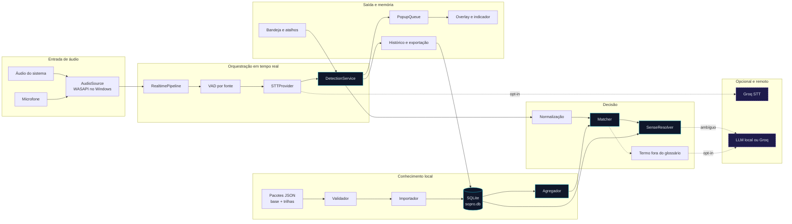

# 01 — Visão geral do sistema

**Estado:** implementado no modo local; a Fase 7 planeja conta e dados em nuvem.

O Sopro é um aplicativo local-first. O caminho principal transforma áudio em um cartão
curto com termo, tradução e definição. O glossário local é o caminho rápido; embeddings,
LLM e provedores de IA em nuvem são **exceções opcionais**, usadas apenas para desambiguar
ou explicar um termo que não está no glossário. A Fase 7 planeja mover histórico e
glossários do usuário para Clerk/Neon/R2, mantendo cache/outbox offline e áudio sempre local.

## Diagrama geral

## Sequência do caminho principal

1. O app resolve a pasta de dados (`SOPRO_HOME` ou `%LOCALAPPDATA%\Sopro`) e abre o SQLite.
2. O glossário ativo é importado e agregado: **base + trilhas ativas**.
3. A captura entrega quadros PCM de 16 kHz, mono, 20–30 ms, etiquetados como `system` ou
   `mic`.
4. O VAD forma segmentos de fala; cada segmento é transcrito pelo `STTProvider`.
5. O `DetectionService` normaliza o texto, casa termos no `Matcher` e escolhe a acepção no
   `SenseResolver`.
6. A detecção é persistida na sessão e oferecida à `PopupQueue`; o overlay apresenta o
   cartão.
7. O histórico consulta o mesmo SQLite; configurações e cache também vivem nele.
8. Se o provedor remoto estiver desligado, indisponível ou sem consentimento, o app degrada
   para o caminho local e continua funcionando.

## Camadas e regra de dependência

| Camada | Exemplos | Pode depender de |
|---|---|---|
| `app` | `run.py`, `realtime.py`, `detection.py`, instância única | `core`, `platform` |
| `platform` | áudio WASAPI, STT faster-whisper/Groq, PySide6, bandeja | `core` |
| `core` | glossário, matcher, RAG, LLM, repositório, configuração | apenas biblioteca padrão e dependências leves |
| Dados | SQLite, pacotes JSON, cache de modelos, logs | sistema de arquivos local |
| Externo | Groq STT/LLM | só com opt-in e consentimento |

A regra central é: **`core` não importa `platform`, Qt nem APIs de sistema operacional**.
Isso permite testar o núcleo sem áudio/UI e portar a captura para outro SO sem reescrever a
detecção.

## Limites de confiança

- Áudio e transcrições ficam em memória e não são gravados por padrão.
- O SQLite guarda histórico, configurações, termos, acepções e vetores — não o áudio.
- Provedores em nuvem só recebem dados após consentimento explícito; a bandeja mostra o
  estado remoto.
- Logs não incluem conteúdo de fala por padrão.
- Nenhuma telemetria é enviada.

## Onde cada fluxo aprofunda

- Entrada de áudio: [03-captura-de-audio.md](03-captura-de-audio.md)
- Transcrição: [04-transcricao.md](04-transcricao.md)
- Casamento e política: [05-deteccao-e-decisao.md](05-deteccao-e-decisao.md)
- Desambiguação: [06-resolucao-de-acepcoes.md](06-resolucao-de-acepcoes.md)
- Saída: [07-popups-e-historico.md](07-popups-e-historico.md)
- Conhecimento: [08-glossarios-e-trilhas.md](08-glossarios-e-trilhas.md)
- Dados: [12-dados-e-persistencia.md](12-dados-e-persistencia.md)
