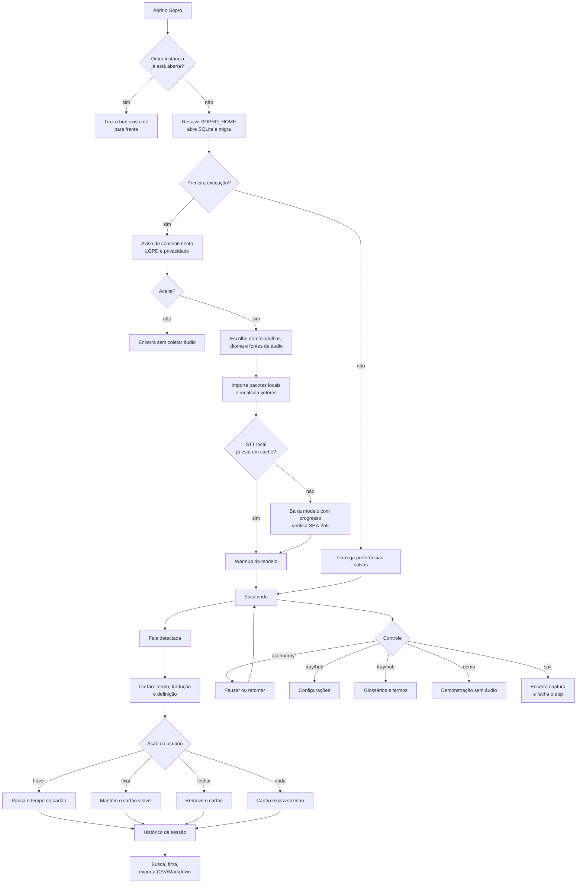

# 02 — Jornada do usuário

**Estado:** implementado.

Este fluxo descreve o que a pessoa vê e decide, não os detalhes internos. Há dois momentos:
a **primeira execução** (consentimento, escolha de glossário/fontes e preparação do modelo) e
o **uso no dia a dia** (escutar, receber o cartão, consultar o histórico e ajustar
preferências).

## Primeira execução e uso diário

## O que o usuário percebe

| Momento | Feedback esperado |
|---|---|
| App abrindo | Indicador em `Carregando`; bandeja mostra o estado |
| Download do modelo | Progresso no indicador/bandeja, sem diálogo modal |
| Falha de áudio ou modelo | Estado `Erro`, mensagem curta e ação de tentar de novo |
| Escutando | Indicador pulsando com o nível de áudio |
| Analisando um trecho | Indicador em `Analisando` enquanto transcreve/resolve |
| Cartão exibido | Sem roubar foco; som opcional; hover pausa; fixar/ fechar |
| Pausado | Indicador em `Pausado`; nenhum novo cartão |
| Nuvem ativa | Sinal permanente na bandeja/hub |

## Decisões de produto embutidas

- **Consentimento antes de ouvir**: a primeira execução apresenta o aviso de privacidade e
  só segue com aceite.
- **Escolha explícita de fontes**: microfone e áudio do sistema podem ser ligados ou
  desligados independentemente.
- **Demonstração sem risco**: `--demo` exercita o pipeline com dados sintéticos, sem áudio
  real e sem download de modelo.
- **Fechar janelas não encerra o app**: o Sopro vive na bandeja; apenas “Sair” encerra.
- **Histórico é local**: exportar é uma ação do usuário; não há sincronização automática.

## Falhas e recuperação

| Situação | Comportamento |
|---|---|
| Nenhum dispositivo de áudio | Estado de erro com mensagem; o app permanece aberto |
| Modelo indisponível/offline | Falha clara; o usuário pode tentar de novo ou usar STT em nuvem, se configurado |
| Groq sem chave ou sem rede | Degradação para o provedor local |
| Glossário inválido | Importação recusada com erro; o pacote anterior continua ativo |
| Banco corrompido | O app não deve sobrescrever dados sem aviso; ver [12-dados-e-persistencia.md](12-dados-e-persistencia.md) |

## Ligações

- Configurações e bandeja: [11-configuracoes-e-bandeja.md](11-configuracoes-e-bandeja.md)
- Cartões e histórico: [07-popups-e-historico.md](07-popups-e-historico.md)
- Glossários: [08-glossarios-e-trilhas.md](08-glossarios-e-trilhas.md)
