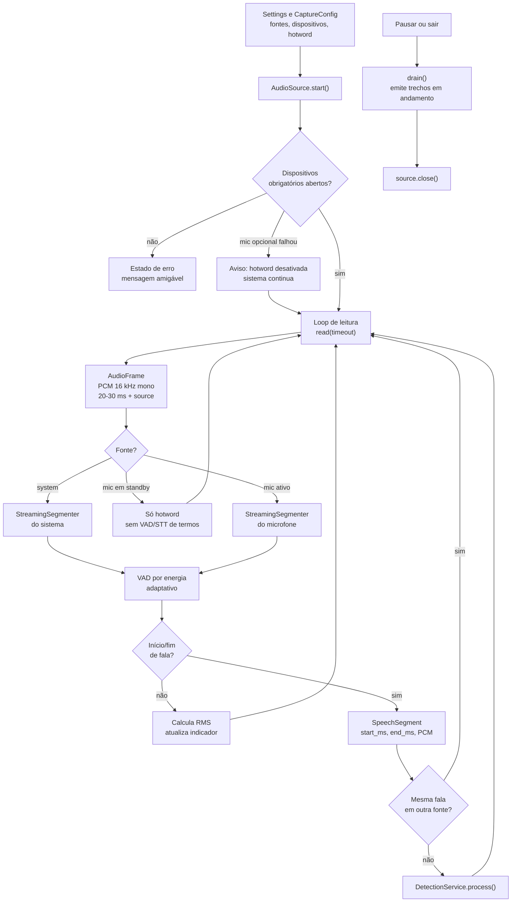

# 03 — Captura de áudio e VAD

**Estado:** implementado.

A captura é isolada pela interface `AudioSource`, em `core/audio/contracts.py`. No Windows,
a implementação concreta usa WASAPI loopback para o áudio do sistema e o dispositivo de
entrada para o microfone. O núcleo recebe apenas quadros PCM normalizados.

## Fluxo de captura

## Detalhes que importam

- **Formato único**: 16 kHz, mono, 16 bits little-endian. Qualquer backend deve converter
  para esse contrato antes de entregar o quadro.
- **Etiqueta de fonte**: cada quadro carrega `system` ou `mic`; o cartão usa essa etiqueta e o
  histórico registra a origem.
- **Um segmentador e um contexto por fonte**: sistema e microfone mantêm estados de VAD e
  janelas de desambiguação independentes.
- **Microfone em standby**: com a hotword habilitada, o microfone pode abrir mesmo fora de
  `audio_sources`. Nesse estado ele só alimenta o detector de hotword e reporta nível; não
  transcreve termos. Ao ouvir “sopro”, entra em `ACTIVE` e o segmentador é reiniciado para
  não processar o trecho da palavra.
- **Timeout**: o microfone volta a `STANDBY` após `mic_wake_timeout_s` (padrão 30 s) sem fala.
  Fala no microfone ou novo “sopro” reinicia o contador.
- **Arbitragem e deduplicação**: com o microfone ativo, trechos do sistema aguardam 500 ms.
  Se o microfone produzir a mesma fala no intervalo, ele vence; caso contrário, o sistema é
  processado. Falas repetidas entre fontes também são descartadas por
  `source_dedup_window_s` (padrão 2 s). A análise é separada do commit para permitir que a
  decisão aconteça antes de persistir/enfileirar.
- **Processamento sequencial hoje**: as duas fontes passam pelo mesmo laço; concorrência
  dedicada por fonte é uma evolução possível, não um requisito atual.
- **Nível para a UI**: o RMS alimenta o pulso do indicador e o estado “falando”; o VAD decide
  quando há fala, não a UI. Fonte inativa ainda atualiza o nível, mas não detecta.
- **Falha do microfone opcional**: a hotword é desativada com aviso e o áudio do sistema
  continua sendo capturado. Se o microfone foi escolhido explicitamente, a falha vira erro.
- **Encerramento limpo**: `drain()` libera o último trecho antes de fechar a fonte.

## Parâmetros e pontos de ajuste

| Parâmetro | Onde vive | Efeito |
|---|---|---|
| Fontes ativas | `Settings.audio_sources` | Liga/desliga sistema e microfone |
| Dispositivo do sistema | `Settings.system_device_id` | Seleciona o loopback |
| Dispositivo do microfone | `Settings.mic_device_id` | Seleciona a entrada |
| Hotword | `Settings.hotword_enabled` | Ativa o microfone em standby |
| Timeout do microfone | `Settings.mic_wake_timeout_s` | Silêncio até voltar a `STANDBY` |
| Janela de deduplicação | `Settings.source_dedup_window_s` | Descarta fala repetida entre fontes |
| Limiar de energia | `VadConfig.energy_threshold` | Sensibilidade a fala |
| Quadro | `CaptureConfig.frame_ms` | Latência e granularidade do VAD |
| Duração máxima do trecho | `VadConfig` | Evita segmentos longos demais |

## Falhas comuns

| Falha | Tratamento |
|---|---|
| Dependência de áudio ausente | `AudioUnavailable`; a UI mostra orientação de instalação |
| Dispositivo removido | `DeviceNotFound`; erro claro e possibilidade de tentar de novo |
| Microfone opcional indisponível | Aviso, hotword desativada; áudio do sistema continua |
| Silêncio prolongado | Nenhum segmento é emitido; o indicador continua no nível baixo |
| Duas fontes iguais | Deduplicação por transcrição/termo; cada fonte mantém seu próprio VAD |
| Conflito de I/O | `check_audio_io_conflict` registra aviso antes de iniciar |

## O que não acontece aqui

- O áudio **não é gravado em disco**.
- O VAD não transcreve nem decide termos.
- A captura não conhece glossário, matcher ou pop-up.
- A hotword não escuta o áudio do sistema.

## Ligações

- Transcrição: [04-transcricao.md](04-transcricao.md)
- Detecção: [05-deteccao-e-decisao.md](05-deteccao-e-decisao.md)
- Privacidade e dados: [12-dados-e-persistencia.md](12-dados-e-persistencia.md)
