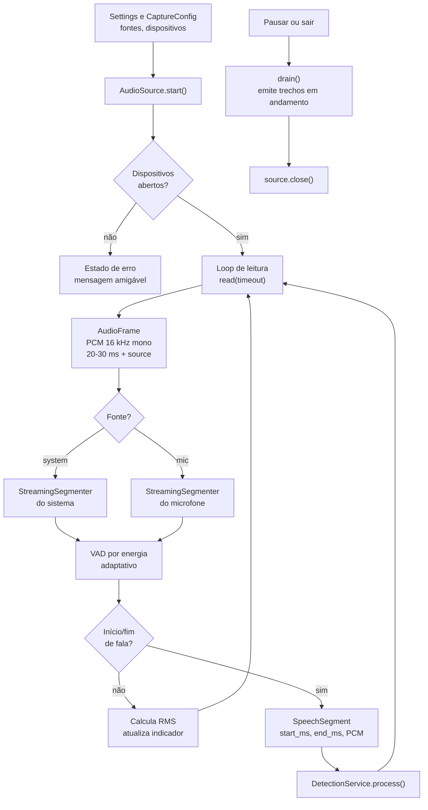

# 03 — Captura de áudio e VAD

**Estado:** implementado.

A captura é isolada pela interface `AudioSource`, em `core/audio/contracts.py`. No Windows,
a implementação concreta usa WASAPI loopback para o áudio do sistema e o dispositivo de
entrada para o microfone. O núcleo recebe apenas quadros PCM normalizados.

## Fluxo de captura

## Detalhes que importam

- **Formato único**: 16 kHz, mono, 16 bits little-endian. Qualquer backend deve converter
  para esse contrato antes de entregar o quadro.
- **Etiqueta de fonte**: cada quadro carrega `system` ou `mic`; o cartão usa essa etiqueta e o
  histórico registra a origem.
- **Um segmentador por fonte**: sistema e microfone mantêm estados de VAD independentes.
- **Processamento sequencial hoje**: as duas fontes passam pelo mesmo laço; concorrência
  dedicada por fonte é uma evolução possível, não um requisito atual.
- **Nível para a UI**: o RMS alimenta o pulso do indicador e o estado “falando”; o VAD decide
  quando há fala, não a UI.
- **Encerramento limpo**: `drain()` libera o último trecho antes de fechar a fonte.

## Parâmetros e pontos de ajuste

| Parâmetro | Onde vive | Efeito |
|---|---|---|
| Fontes ativas | `Settings.audio_sources` | Liga/desliga sistema e microfone |
| Dispositivo do sistema | `Settings.system_device_id` | Seleciona o loopback |
| Dispositivo do microfone | `Settings.mic_device_id` | Seleciona a entrada |
| Limiar de energia | `VadConfig.energy_threshold` | Sensibilidade a fala |
| Quadro | `CaptureConfig.frame_ms` | Latência e granularidade do VAD |
| Duração máxima do trecho | `VadConfig` | Evita segmentos longos demais |

## Falhas comuns

| Falha | Tratamento |
|---|---|
| Dependência de áudio ausente | `AudioUnavailable`; a UI mostra orientação de instalação |
| Dispositivo removido | `DeviceNotFound`; erro claro e possibilidade de tentar de novo |
| Silêncio prolongado | Nenhum segmento é emitido; o indicador continua no nível baixo |
| Duas fontes iguais | Cada uma mantém seu próprio VAD; não há mistura de canais |
| Conflito de I/O | `check_audio_io_conflict` registra aviso antes de iniciar |

## O que não acontece aqui

- O áudio **não é gravado em disco**.
- O VAD não transcreve nem decide termos.
- A captura não conhece glossário, matcher ou pop-up.

## Ligações

- Transcrição: [04-transcricao.md](04-transcricao.md)
- Detecção: [05-deteccao-e-decisao.md](05-deteccao-e-decisao.md)
- Privacidade e dados: [12-dados-e-persistencia.md](12-dados-e-persistencia.md)
