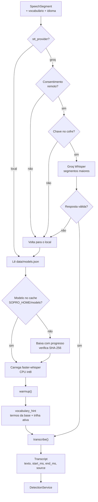

# 04 — Transcrição e modelos de fala

**Estado:** implementado.

A transcrição é a única etapa que transforma áudio em texto. O Sopro usa **Whisper local por
padrão** e oferece **Groq como opção remota**. O contrato `STTProvider` esconde o motor e
permite trocar a implementação sem alterar o restante do pipeline.

## Fluxo do provedor

## Decisões do fluxo

- **Local primeiro**: o instalador não embute modelos; o download acontece na primeira
  execução, com verificação de integridade e progresso na UI.
- **Catálogo, não texto livre**: o modelo é escolhido em `data/models.json`, evitando IDs
  inexistentes que derrubariam o pipeline.
- **Dica de vocabulário**: o Whisper recebe termos do glossário agregado (base + trilhas
  ativas), com termos da trilha ativa antes dos genéricos, truncados em ~220 tokens.
- **Degradação**: falha de rede, chave ausente ou resposta inválida não encerram o app; o
  caminho local assume.
- **Privacidade**: no modo local o áudio não sai da máquina; no modo Groq, o segmento é
  enviado à nuvem apenas com opt-in e consentimento persistido.

## Entradas e saídas do contrato

| Entrada | Saída |
|---|---|
| bytes PCM do segmento | texto transcrito |
| taxa de amostra e idioma | `start_ms` / `end_ms` |
| etiqueta da fonte (`system`/`mic`) | `source` |
| dica de vocabulário | confiança, quando o provedor oferece |

## Erros esperados

| Erro | Comportamento |
|---|---|
| Modelo ausente e sem rede | Erro claro; nova tentativa disponível |
| SHA-256 divergente | Download recusado; nada é carregado |
| Groq sem chave | Aviso e fallback local |
| Limite de taxa | Falha da chamada e fallback local; orçamento de candidatos é separado |
| Segmento vazio | Nenhuma detecção; o fluxo continua |

## Onde o texto vai depois

O texto transcrito entra no [fluxo de detecção](05-deteccao-e-decisao.md). A transcrição
**não** é persistida por padrão; apenas a detecção (termo, acepção e método) é gravada.

## Ligações

- Captura e VAD: [03-captura-de-audio.md](03-captura-de-audio.md)
- Modelos, nuvem e LLM: [10-modelos-e-llm.md](10-modelos-e-llm.md)
- Privacidade: [12-dados-e-persistencia.md](12-dados-e-persistencia.md)
