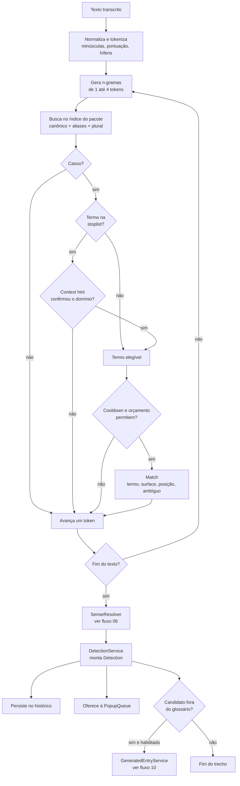

# 05 — Detecção de termos e decisão de exibição

**Estado:** implementado.

A detecção recebe o texto do STT e produz uma lista de `Match` elegíveis. O matcher é
determinístico: normaliza, procura o maior n-grama possível e aplica políticas de exibição.
Ele não chama LLM e não decide qual acepção mostrar — isso é papel do resolvedor.

## Fluxo de detecção

## Regras do matcher

1. **Maior casamento primeiro**: de 4 para 1 token. “machine learning” não deve virar
   “machine” + “learning”.
2. **Canônico, aliases e plural conservador**: o plural é gerado por regra simples, sem
   lematização pesada.
3. **Stoplist com contexto**: termos comuns (`model`, `token`, `layer`, `class`…) só disparam
   se um `context_hint` aparecer na janela de contexto.
4. **Cooldown por termo**: evita repetir o mesmo cartão em sequência.
5. **Orçamento por minuto**: limita o total de pop-ups; a política fica no matcher para não
   duplicar regras na fila visual.
6. **Desempate por prioridade**: quando duas entradas casam na mesma chave, a de menor
   `priority` vence.

## O que a `Detection` carrega

| Campo | Uso |
|---|---|
| `term` | Forma canônica, chave do histórico e do cooldown |
| `surface` | Como apareceu no texto |
| `source` | `system` ou `mic` |
| `ambiguous` / `sense_count` | Indica ao cartão que há mais de uma acepção |
| `translation` / `definition` | Conteúdo escolhido pelo resolvedor |
| `resolve_method` | `single_sense`, `track`, `domain_tag`, `vector`, `llm` |
| `track` | Trilha da acepção escolhida |
| `detection_id` | Referência no histórico, quando persistida |

## Termo fora do glossário

Se `llm_candidates` estiver ligado, o serviço extrai sintagmas candidatos que não estão no
glossário nem na stoplist, respeita `llm_candidates_per_minute` e consulta o provedor de LLM.
O resultado vai para `generated_entry` e para o cartão com aviso de conteúdo gerado; ele só
vira glossário após aprovação humana.

## Falhas e limites

- Texto vazio ou sem termos: nenhum cartão, nenhum erro.
- STT com erro de grafia: aliases e correspondência aproximada configurável ajudam; não há
  correção gramatical automática.
- Excesso de falsos positivos: ajustar stoplist, hints, cooldown e orçamento — não aumentar
  o limiar do resolvedor.

## Ligações

- Resolução de acepções: [06-resolucao-de-acepcoes.md](06-resolucao-de-acepcoes.md)
- Pop-ups e histórico: [07-popups-e-historico.md](07-popups-e-historico.md)
- Glossários: [08-glossarios-e-trilhas.md](08-glossarios-e-trilhas.md)
