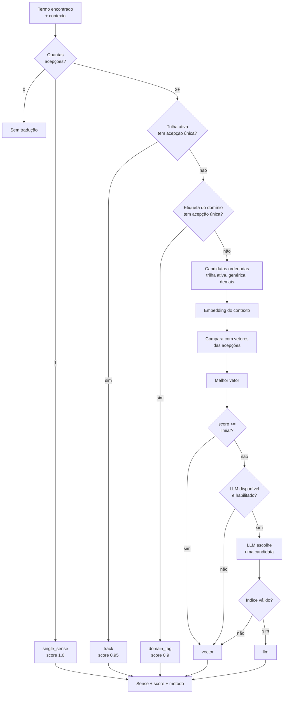

# 06 — Resolução de acepções e RAG

**Estado:** implementado.

Quando um termo tem mais de um sentido, o `SenseResolver` escolhe qual mostrar. A cascata é
barata primeiro e só chega ao LLM se a similaridade vetorial ficar abaixo do limiar. O
resolvedor não participa de toda frase: ele só é chamado para termos que o matcher já
encontrou.

## Cascata de decisão

## Ordem de preferência das trilhas

No pacote agregado, as acepções são ordenadas por:

1. acepção específica da **trilha ativa**;
2. acepção **genérica** (sem `track`);
3. acepções de outras trilhas.

Se houver exatamente uma acepção da trilha ativa, o resolvedor a escolhe com método `track`.
Se houver várias, a similaridade vetorial decide entre elas e as demais candidatas.

## Embeddings e persistência

- Cada acepção tem um vetor `float32` persistido em `sense_vec`.
- O texto vetorizado combina tradução, definição, etiqueta de domínio e exemplo.
- O embedder padrão é offline; `sentence-transformers` é opcional.
- No pacote agregado, os ordinais são renumerados. Por isso, `embed_aggregate` mapeia cada
  acepção de volta à sua origem por `(canônico, tradução, track)` antes de gravar o vetor.
- O resolvedor usa a chave `(canônico, ordinal)` do pacote em memória.

## Métodos registrados

| Método | Quando ocorre | Custo |
|---|---|---|
| `single_sense` | Só existe uma acepção | Nenhum |
| `track` | Trilha ativa tem uma única acepção | Baixo |
| `domain_tag` | Só uma acepção tem a etiqueta do domínio | Baixo |
| `vector` | Similaridade de embeddings | Médio |
| `llm` | Vetor abaixo do limiar e LLM habilitado | Alto, opcional |

O método escolhido é persistido na detecção e aparece no histórico, o que ajuda a auditar a
qualidade da desambiguação.

## Limiar e janela de contexto

- `resolution_threshold`: abaixo dele, o LLM pode ser consultado.
- `resolution_window_s`: últimos N segundos de transcrição entram como contexto.
- Sem contexto e sem LLM, o resolvedor ainda devolve a melhor acepção vetorial; nunca
  bloqueia o cartão.

## Ligações

- Matcher: [05-deteccao-e-decisao.md](05-deteccao-e-decisao.md)
- Glossários e trilhas: [08-glossarios-e-trilhas.md](08-glossarios-e-trilhas.md)
- LLM e modelos: [10-modelos-e-llm.md](10-modelos-e-llm.md)
