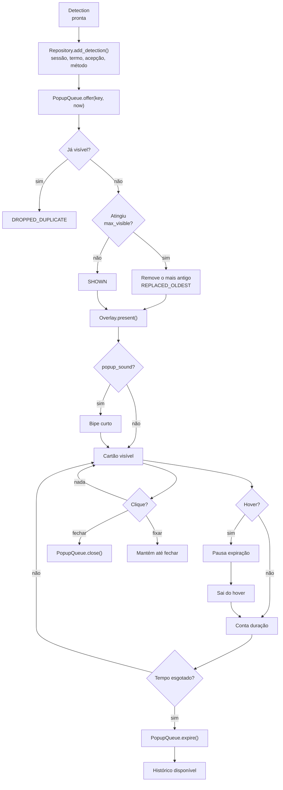

# 07 — Pop-ups, fila e histórico

**Estado:** implementado.

A exibição é separada da decisão. O matcher decide **se** um termo pode aparecer; a
`PopupQueue` decide **como** os cartões ocupam a tela; o overlay apenas desenha o que a fila
entrega. O histórico é gravado antes da exibição, para que o cartão nunca seja a única cópia
do evento.

## Fluxo de exibição e persistência

## Regras da fila

- **Deduplicação por termo**: o mesmo termo não ocupa dois cartões ao mesmo tempo.
- **Limite de simultâneos**: padrão 3; ao encher, o mais antigo sai.
- **Expiração por tempo**: padrão definido em `popup_duration_s`; hover pausa o relógio.
- **Som opcional**: bipe curto, abaixo da duração mínima de fala do VAD.
- **Sem foco**: o cartão não ativa a janela nem interrompe a reunião.
- **Fixar**: mantém o cartão até ação explícita do usuário.

## O que é persistido

| Tabela | Conteúdo |
|---|---|
| `session` | Início/fim, título e fontes de áudio |
| `detection` | Termo, acepção, horário, fonte, método e `learned` |
| `setting` | Preferências, incluindo posição do indicador e consentimento |
| `generated_entry` | Termos fora do glossário aguardando aprovação |
| `sense_vec` | Vetores por acepção, quando o RAG é usado |

O `context_snippet` é opcional e desligado por padrão. A transcrição completa não é gravada
por padrão.

## Histórico e exportação

O hub oferece busca, filtro por “aprendido” e por período, além de exportação CSV/Markdown.
Excluir um termo do glossário preserva as detecções antigas, apenas desvinculando
`term_id`/`sense_id`. O histórico é a fonte para auditoria de falsos positivos e para calibrar
stoplist, cooldown e orçamento.

## Ligações

- Decisão de exibição: [05-deteccao-e-decisao.md](05-deteccao-e-decisao.md)
- Interface e hub: [11-configuracoes-e-bandeja.md](11-configuracoes-e-bandeja.md)
- Persistência: [12-dados-e-persistencia.md](12-dados-e-persistencia.md)
