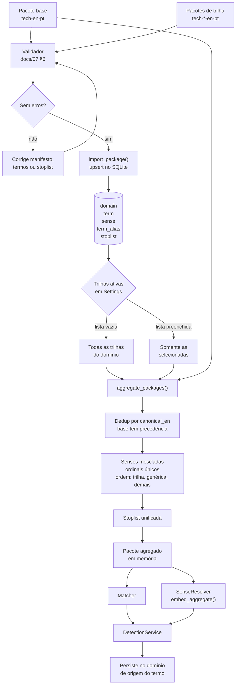

# 08 — Glossários, trilhas e agregação

**Estado:** implementado no núcleo; a seleção visual dedicada de trilhas é parcial.

Um **domínio** é um pacote de conhecimento (por exemplo, tecnologia). Uma **trilha** é um
sub-pacote do mesmo domínio (programação, dados, DevOps, frontend, backend). A trilha não
muda o `domain_tag`; ela refina o vocabulário e as acepções.

## Estrutura de arquivos

```text
data/domains/
  tech-en-pt/                  base: conceitos transversais
    manifest.json
    terms.json
    stoplist.txt
  tech-programming-en-pt/      trilha: parent_slug = tech-en-pt
    manifest.json
    terms.json
    stoplist.txt
  tech-data-science-en-pt/
  tech-devops-en-pt/
  tech-frontend-en-pt/
  tech-backend-en-pt/
```

## Do arquivo ao runtime



## Regras de composição

| Situação | Resultado |
|---|---|
| Termo só na base | Permanece genérico |
| Termo só na trilha | Entra no agregado com `tracks` da trilha |
| Termo na base e na trilha | Metadados da base vencem; acepções são somadas |
| Mesmo termo em duas trilhas ativas | Uma entrada; acepções das duas trilhas são preservadas |
| Trilha inativa | Seus termos e acepções ficam fora do agregado |
| `tracks_mode="all"` | Todas as trilhas filhas da base são carregadas |
| `tracks_mode="base"` | Somente a base, sem trilhas |
| `tracks_mode="custom"` | Apenas as trilhas listadas em `active_tracks` |
| `active_domains` aponta para trilha | A base é inferida por `parent_slug` |

## Por que agregar em vez de importar tudo

- O matcher precisa de uma visão única, sem termos duplicados.
- O resolvedor precisa de ordinais estáveis por termo.
- A UI e o histórico persistem a detecção no **domínio de origem**, não no agregado.
- A seleção de trilhas muda o vocabulário e o RAG sem exigir reinstalação.

## Detalhes de implementação

- `parent_slug` vazio identifica o pacote base; `track` vazio também.
- `track_order` define a ordem de exibição e de preferência.
- `term.tracks` lista as trilhas do termo; `sense.track` marca a acepção específica.
- `build_aggregate_from_repo(repo, base_slug, active_tracks)` carrega tudo do SQLite.
- A UI usa a árvore compartilhada `platform/popup/glossary_tree.py` em Glossários,
  Configurações e primeira execução; a seleção é persistida em `tracks_mode` +
  `active_tracks`.

## Criação de um novo glossário

O passo a passo para contribuidores está em
[09-construcao-de-glossario.md](09-construcao-de-glossario.md) e no
[CONTRIBUTING.md](../../CONTRIBUTING.md#criando-um-glossário-ou-uma-trilha).

## Ligações

- Formato detalhado: [docs/07 §7](../07-glossario-seed-modelo.md)
- Resolução: [06-resolucao-de-acepcoes.md](06-resolucao-de-acepcoes.md)
- Dados: [12-dados-e-persistencia.md](12-dados-e-persistencia.md)
