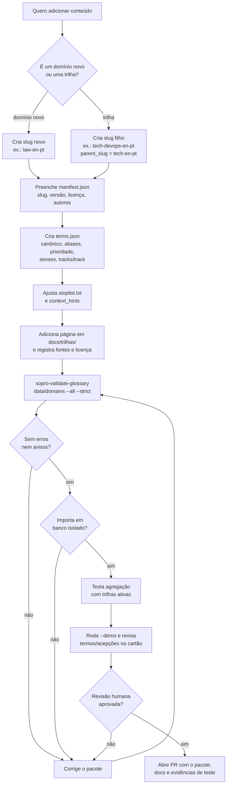

# 09 — Construção de um glossário ou trilha

**Estado:** implementado.

Este é o fluxo para quem quer adicionar **conteúdo**, não código. Um novo glossário ou uma
nova trilha deve ser apenas um pacote de domínio em `data/domains/`. O núcleo não precisa
mudar. Se precisar, a mudança é uma evolução de formato e deve ser discutida antes.

O passo a passo detalhado, com checklist de qualidade e licença, está no
[CONTRIBUTING.md](../../CONTRIBUTING.md#criando-um-glossário-ou-uma-trilha).

## Fluxo do contribuidor



## Passo a passo mínimo

1. **Escolha o tipo**: um domínio novo (ex.: `law-en-pt`) ou uma trilha de um domínio
   existente (ex.: `tech-devops-en-pt`, com `parent_slug: "tech-en-pt"`).
2. **Crie a pasta** em `data/domains/<slug>/` com `manifest.json`, `terms.json` e
   `stoplist.txt`.
3. **Preencha o manifesto**: `slug`, `name`, `version`, `source_lang`, `output_langs`,
   `license`, `authors`, `created_at`. Em trilha, inclua `parent_slug`, `track`,
   `track_label` e `track_order`.
4. **Escreva os termos**: até 25 palavras por definição, português do Brasil, acepções
   separadas por sentido. Em trilha, use `tracks` no termo e `track` na acepção específica.
5. **Ajuste a stoplist** para palavras comuns que só devem disparar com contexto.
6. **Documente fontes e licença** em `docs/trilhas/<trilha>.md`; conteúdo de terceiros exige
   verificação de licença.
7. **Valide**:

   ```bash
   sopro-validate-glossary data/domains --all --strict
   ```

8. **Teste a importação em banco isolado** e a agregação:

   ```bash
   SOPRO_HOME=/tmp/sopro-glossario python -m sopro --demo \
     --domains-root data/domains
   ```

   No PowerShell, use `$env:SOPRO_HOME = "$env:TEMP\sopro-glossario"` antes do comando.
9. **Revise uma amostra de pelo menos 20 termos** e marque `needs_review=false` apenas após
   revisão humana.
10. **Abra o PR** com o pacote, a página de documentação e a saída da validação.

## O que evitar

- Termos duplicados dentro do mesmo `terms.json`.
- Definições longas, opinativas ou copiadas sem licença.
- Trilha sem `track_order`, sem `track_label` ou com `parent_slug` apontando para si mesma.
- Pacote base declarando `track` ou `parent_slug`.
- Marcar termos gerados por IA como curados sem revisão.
- Alterar `core` para “encaixar” um glossário: o formato deve acomodar o conteúdo.

## Quando é preciso mexer no código

Só quando o **formato** muda (novo campo, nova relação, nova regra de agregação). Nesse caso,
a mudança precisa tocar, no mínimo: `package.py`, `models.py`, `migrations.py`,
`repository.py`, `importer.py`, `validate.py` e testes de ida e volta. O
[CONTRIBUTING.md](../../CONTRIBUTING.md) descreve as regras de arquitetura e de teste.

## Ligações

- Estrutura e agregação: [08-glossarios-e-trilhas.md](08-glossarios-e-trilhas.md)
- Formato: [docs/07](../07-glossario-seed-modelo.md)
- Qualidade: [14-testes-e-qualidade.md](14-testes-e-qualidade.md)
