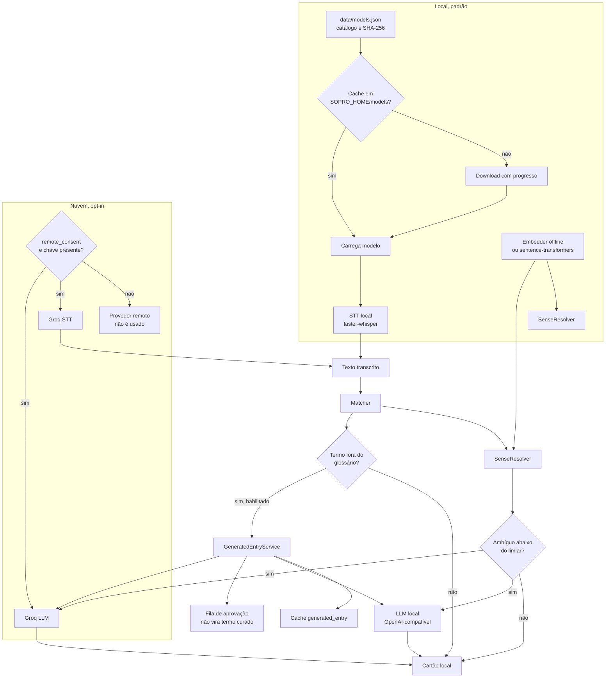

# 10 — Modelos, LLM e fronteira de privacidade

**Estado:** implementado.

O Sopro separa quatro caminhos: STT local, STT em nuvem, desambiguação por LLM e geração de
termos fora do glossário. Todos passam por interfaces e todos têm um caminho local ou de
degradação. A nuvem é sempre **opt-in**.

## Fluxo de modelos e provedores

## Decisões de arquitetura

| Tema | Decisão |
|---|---|
| STT padrão | Local, `faster-whisper`, CPU, int8 |
| Download | Sob demanda, com catálogo, SHA-256, progresso e cache |
| Nuvem | Groq apenas com consentimento explícito e chave no cofre |
| LLM | Só para ambiguidade ou termo fora do glossário |
| Cache de LLM | `generated_entry`, separado de `term`/`sense` |
| Aprovação | Conteúdo gerado só vira curado após revisão humana |
| Falha remota | Degradação para local, nunca derrubar o app |
| Logs | Sem conteúdo de fala por padrão |

## Privacidade

- Áudio local nunca é gravado em disco.
- No modo local, áudio e texto não saem da máquina.
- No modo Groq, o segmento de áudio é enviado ao provedor; o usuário precisa ter consentido.
- A bandeja/hub indica quando há provedor remoto ativo.
- Chaves de API não aparecem em logs.
- O histórico guarda a detecção, não a transcrição completa.

## Quando o LLM entra — e quando não entra

O LLM **não** processa toda frase. Ele só é chamado quando:

1. o termo é ambíguo e a similaridade vetorial fica abaixo do limiar; ou
2. o termo não está no glossário e `llm_candidates` está ligado.

Isso mantém latência, CPU e custo baixos, além de tornar o comportamento previsível.

## Ligações

- Transcrição: [04-transcricao.md](04-transcricao.md)
- Resolução: [06-resolucao-de-acepcoes.md](06-resolucao-de-acepcoes.md)
- Privacidade e dados: [12-dados-e-persistencia.md](12-dados-e-persistencia.md)
