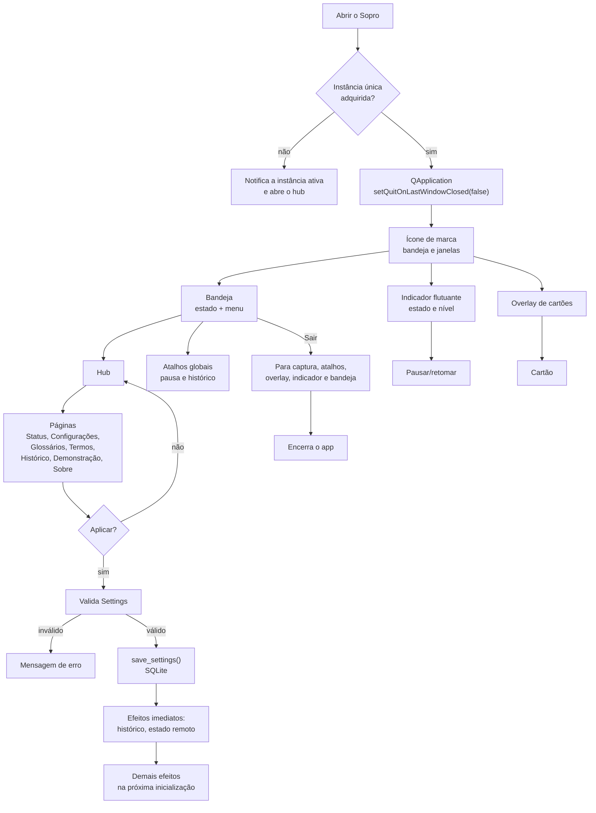

# 11 — Hub, configurações, bandeja e atalhos

**Estado:** parcial. O hub, as configurações, a bandeja e os atalhos existem; a seleção
visual dedicada de trilhas ainda está em evolução.

O Sopro não é um app de janela principal. Ele vive na **bandeja**, mostra cartões sobre outras
janelas e oferece um **hub** sob demanda. Fechar o hub não encerra o processo; apenas “Sair”
encerra.

## Fluxo de interface e controle

## Páginas do hub

| Página | Para quê |
|---|---|
| Status | Estado atual, fontes, domínio ativo e ações rápidas |
| Configurações | Áudio, idioma, STT, LLM, pop-up, cooldown, tema, atalhos e privacidade |
| Glossários | Pacotes disponíveis, importar/exportar e ativar |
| Termos | Buscar, editar, criar e excluir termos e acepções |
| Histórico | Buscar, filtrar e exportar detecções |
| Demonstração | Ver cartões de exemplo sem áudio real |
| Sobre | Licença, terceiros, consentimento e créditos |

## Configurações que afetam o pipeline

| Grupo | Campos |
|---|---|
| Áudio | fontes, dispositivo do sistema, dispositivo do microfone |
| Transcrição | provedor, modelo do catálogo, modelo Groq |
| LLM | provedor, modelo, URL base, candidatos e limite por minuto |
| Glossário | domínios ativos e trilhas ativas |
| Exibição | duração, máximo de cartões, posição, som, tema, fonte |
| Política | cooldown, orçamento por minuto, similaridade e janela de contexto |
| Privacidade | salvar contexto, salvar transcrição, consentimento remoto |
| Interface | indicador, posição, atalhos globais |

## Comportamentos importantes

- **Instância única**: reabrir o executável ativa a instância existente em vez de duplicar a
  captura.
- **Sem roubo de foco**: overlay e indicador usam flags de janela que não ativam o app.
- **Indicador arrastável**: a posição é persistida nas configurações.
- **Atalhos globais**: pausar/retomar e abrir o histórico diretamente.
- **Salvamento**: a maior parte das mudanças é persistida e aplicada na próxima
  inicialização; histórico e estado remoto são atualizados imediatamente.
- **Fechar não sai**: o app continua na bandeja até “Sair”.

## Limitações atuais

- A tela de glossários lista pacotes importados; a seleção de trilhas por caixa de seleção
  ainda não está dedicada na UI.
- A edição de termos não substitui a curadoria no arquivo fonte; exportar/importar é o
  caminho para consolidar mudanças.

## Ligações

- Jornada do usuário: [02-jornada-do-usuario.md](02-jornada-do-usuario.md)
- Pop-ups: [07-popups-e-historico.md](07-popups-e-historico.md)
- Glossários: [08-glossarios-e-trilhas.md](08-glossarios-e-trilhas.md)
