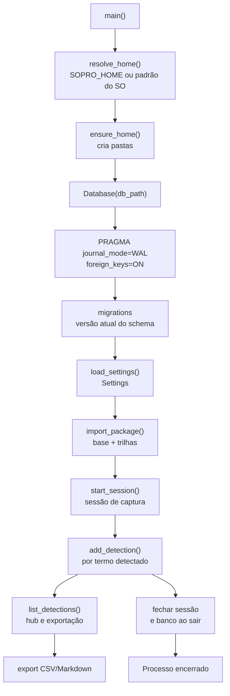

# 12 — Dados, SQLite e ciclo de vida

**Estado:** implementado no modo local; a Fase 7 planeja nuvem.

Hoje todo o estado persistente do Sopro fica na pasta de dados do usuário. O banco é SQLite
com WAL e uma conexão por thread; migrações versionadas garantem compatibilidade entre
versões. Áudio não é persistido.

Na **Fase 7 planejada**, a nuvem (Neon + R2) passa a ser a fonte da verdade do histórico,
configurações e glossários do usuário; o SQLite vira cache + outbox offline. O áudio continua
fora de qualquer upload.

## Onde ficam os dados

| Caminho | Conteúdo |
|---|---|
| `~/.sopro/` (fonte) | Pasta padrão em desenvolvimento |
| `%LOCALAPPDATA%\Sopro\` (executável) | Pasta padrão no Windows empacotado |
| `SOPRO_HOME` | Sobrescreve a pasta; útil para testes e modo portátil |
| `sopro.db` | Banco SQLite |
| `models/` | Cache de modelos de STT |
| `logs/` | Logs sem conteúdo de fala por padrão |

## Fluxo de inicialização e persistência

## Tabelas principais

| Tabela | Papel |
|---|---|
| `domain` | Pacote base ou trilha, com `parent_slug`, `track`, `track_label`, `track_order` |
| `term` | Termo canônico, prioridade, ambiguidade, stoplist e `tracks` |
| `term_alias` | Aliases e variações |
| `sense` | Acepções, com `track` opcional |
| `stoplist` | Palavras que exigem contexto |
| `term_fts` | Busca textual |
| `sense_vec` | Vetores `float32` por acepção |
| `session` | Sessões de captura |
| `detection` | Histórico de termos exibidos |
| `generated_entry` | Conteúdo gerado aguardando aprovação |
| `setting` | Preferências e consentimento |

## Migrações

As migrações são numeradas e aplicadas em ordem. A versão 6 introduziu os campos de trilha
(`parent_slug`, `track`, `track_label`, `track_order`, `term.tracks`, `sense.track`) e índices
para consulta por pai e por trilha. Uma migração nova deve:

1. ser idempotente dentro da transação;
2. preservar dados existentes;
3. ter teste de atualização a partir da versão anterior;
4. atualizar importação, exportação e modelos em conjunto.

## Regras de privacidade

- Áudio não é gravado.
- Transcrição completa não é gravada por padrão.
- `context_snippet` é opcional e desligado por padrão.
- Logs não incluem fala.
- Nenhuma telemetria.
- Provedor de IA remoto só recebe dados com consentimento persistido.
- Fase 7 planejada: dados de conta isolados por `user_id`, R2 privado, tokens no cofre do SO e
  exportação/exclusão sob demanda; áudio fora do escopo.

## Backup, exportação e recuperação

- O histórico pode ser exportado em CSV/Markdown pelo hub.
- Pacotes podem ser exportados em JSON com `export_package_json`.
- Para backup manual, copie `sopro.db` com o app fechado ou use o backup do SQLite.
- Em caso de corrupção, não sobrescreva o banco: preserve o arquivo e tente recuperação
  antes de recriar.
- Fase 7 planejada: backup diário no R2 com retenção de 30 dias, restauração testada e
  exportação por usuário; o banco local deixa de ser a cópia definitiva.

## Ligações

- Glossários: [08-glossarios-e-trilhas.md](08-glossarios-e-trilhas.md)
- Pop-ups e histórico: [07-popups-e-historico.md](07-popups-e-historico.md)
- Modelos: [10-modelos-e-llm.md](10-modelos-e-llm.md)
