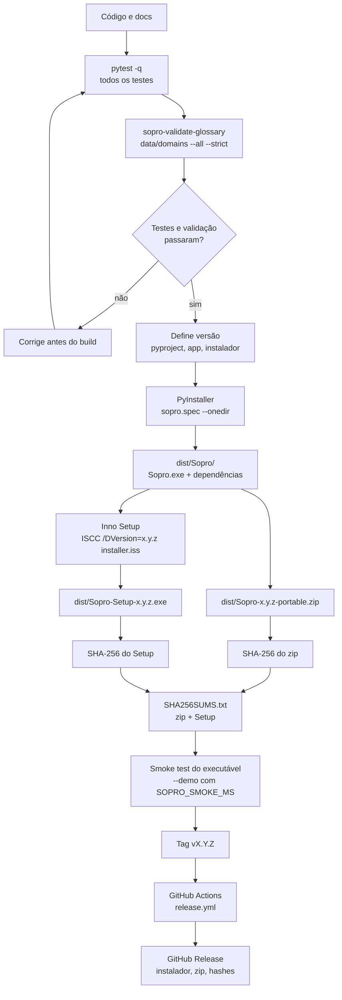

# 13 — Build, empacotamento e release

**Estado:** implementado.

O Sopro é distribuído como **onedir** (pasta com `Sopro.exe` e dependências), zip portátil e
instalador Inno Setup. Modelos de STT **não** entram no pacote: são baixados na primeira
execução. O CI automatiza testes, build, instalador, hashes e publicação em tag `v*`.

## Fluxo do código à release



## Comandos locais

```bash
# ambiente
python -m venv .venv
python -m pip install -e ".[dev,ui,audio,stt,packaging]"

# qualidade
pytest -q
sopro-validate-glossary data/domains --all --strict

# executável portátil
powershell -ExecutionPolicy Bypass -File scripts/build-windows.ps1

# instalador
"C:\Program Files (x86)\Inno Setup 6\ISCC.exe" /DVersion=0.1.0 installer.iss
```

O task runner equivalente é `python scripts/tasks.py build`.

## Artefatos esperados

| Arquivo | Uso |
|---|---|
| `dist/Sopro/Sopro.exe` | Executável onedir |
| `dist/Sopro-x.y.z-portable.zip` | Versão portátil |
| `dist/Sopro-Setup-x.y.z.exe` | Instalador per-user |
| `dist/SHA256SUMS.txt` | Integridade de zip e instalador |

## Regras de release

- Versão semântica: `MAJOR.MINOR.PATCH`; até a primeira release pública, mudanças ficam em
  `Unreleased` no [CHANGELOG](../../CHANGELOG.md).
- O instalador é **per-user**, sem exigir administrador.
- O modelo é baixado no primeiro uso, com progresso e verificação de SHA-256.
- O CI roda em tag `v*`; não publique artefatos gerados de uma árvore suja.
- O `SHA256SUMS.txt` deve cobrir **todos** os artefatos publicados, inclusive o Setup.
- O smoke test `SOPRO_SMOKE_MS` valida que o executável abre e encerra sozinho em ambiente
  headless.

## Checklist antes de publicar

- [ ] `pytest -q` verde.
- [ ] `sopro-validate-glossary data/domains --all --strict` verde.
- [ ] Versão consistente em `pyproject.toml`, executável e instalador.
- [ ] `CHANGELOG.md` atualizado.
- [ ] Smoke test do executável congelado.
- [ ] Hashes do zip e do Setup no `SHA256SUMS.txt`.
- [ ] Tag `vX.Y.Z` criada e workflow concluído.

## Ligações

- Workflow de desenvolvimento: [docs/10](../10-dev-workflow.md)
- Empacotamento detalhado: [docs/09](../09-empacotamento-e-release.md)
- Testes: [14-testes-e-qualidade.md](14-testes-e-qualidade.md)
