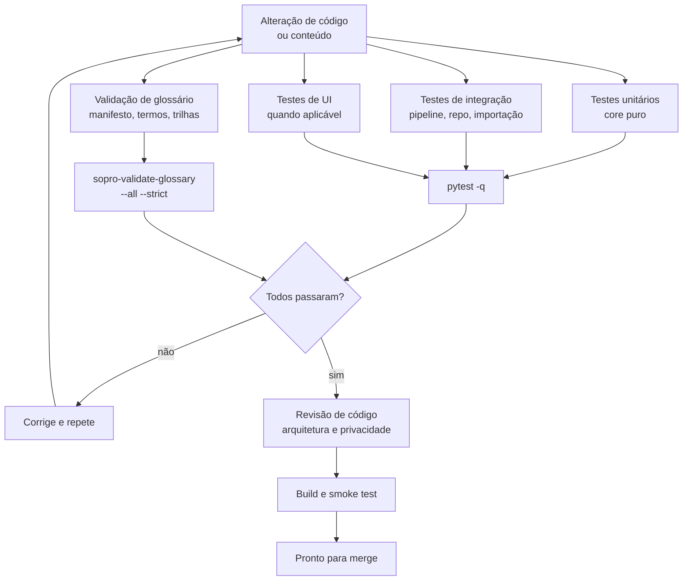

# 14 — Testes e portões de qualidade

**Estado:** implementado.

O núcleo é testado sem UI, áudio real ou rede. Testes de integração exercitam o pipeline com
provedores falsos. A validação de glossário é um portão separado, porque conteúdo também pode
quebrar o produto.

## Fluxo de qualidade



## Camadas de teste

| Camada | Exemplos | O que protege |
|---|---|---|
| Unitário | matcher, resolvedor, normalização, configuração, fila | Regras puras e determinísticas |
| Integração | `DetectionService`, importação/exportação, migrações, RAG | Contratos entre módulos |
| Conteúdo | validador de glossário, agregação base + trilhas | Formato, trilhas, qualidade |
| UI | overlay, hub, configurações, bandeja | Comportamento sem roubo de foco |
| Smoke | executável congelado em `--demo` | Empacotamento e inicialização |

## Comandos

```bash
pytest -q
pytest tests/test_core_rag.py -q
sopro-validate-glossary data/domains --all --strict
python scripts/tasks.py test
python scripts/tasks.py validate data/domains
```

## Regras para contribuir

- Todo código de núcleo novo precisa de teste.
- Correção de bug deve incluir um teste que falharia antes.
- Migração precisa de teste de atualização a partir da versão anterior.
- Recurso de UI deve evitar depender de foco de janela.
- Conteúdo novo precisa passar no validador e na revisão humana.
- Não use dados reais de reunião em fixtures; use exemplos sintéticos.

## Portões de merge

1. `pytest -q` verde.
2. Validador de glossário verde.
3. Sem novas dependências pesadas sem justificativa.
4. `core` sem importar `platform`, Qt ou SO.
5. Privacidade preservada: sem áudio em disco, sem telemetria, logs sem fala.
6. Documentação de fluxo atualizada quando o comportamento mudar.

## Ligações

- Build e release: [13-build-e-release.md](13-build-e-release.md)
- Glossários: [09-construcao-de-glossario.md](09-construcao-de-glossario.md)
- Arquitetura: [01-visao-geral.md](01-visao-geral.md)
