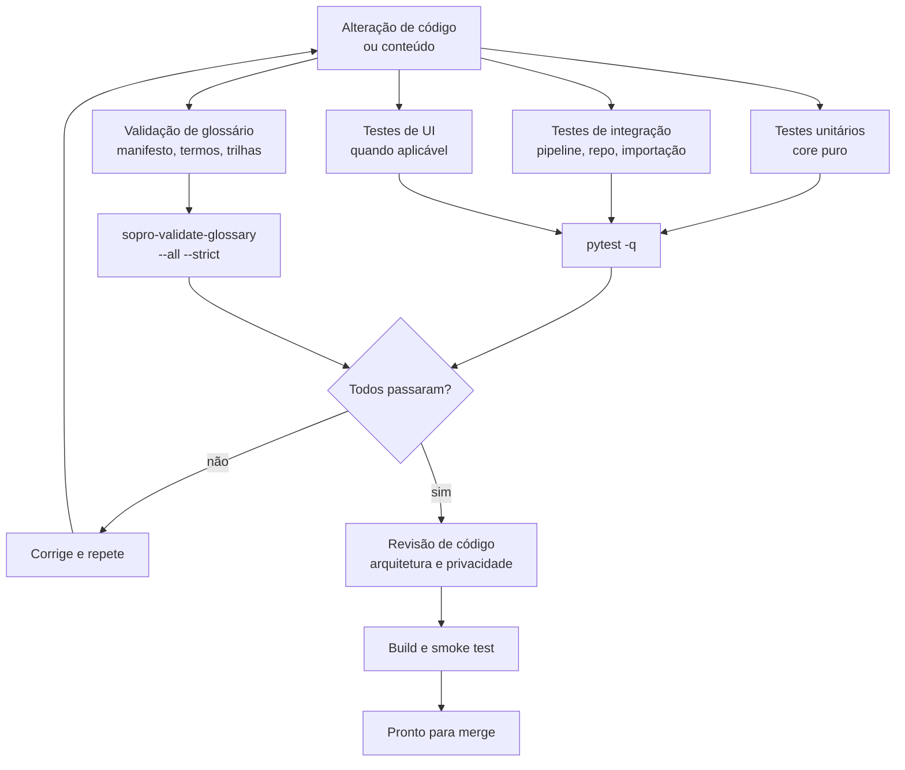

# 14 — Testes e portões de qualidade

**Estado:** implementado.

O núcleo é testado sem UI, áudio real ou rede. Testes de integração exercitam o pipeline com
provedores falsos. A validação de glossário é um portão separado, porque conteúdo também pode
quebrar o produto.

## Fluxo de qualidade



## Camadas de teste

| Camada | Exemplos | O que protege |
|---|---|---|
| Unitário | matcher, resolvedor, normalização, configuração, fila | Regras puras e determinísticas |
| Integração | `DetectionService`, importação/exportação, migrações, RAG | Contratos entre módulos |
| Conteúdo | validador de glossário, agregação base + trilhas | Formato, trilhas, qualidade |
| UI | overlay, hub, configurações, bandeja | Comportamento sem roubo de foco |
| Smoke | executável congelado em `--demo` | Empacotamento e inicialização |

## Roteiro manual — 0.1.1

Plano registrado em **2026-10-31** para o reteste do portátil/instalador 0.1.1. Executar no
`dist/Sopro-0.1.1-portable.zip` (extraído) ou no `Sopro-Setup-0.1.1.exe` instalado.

### Pré-condições

- `sha256sum -c dist/SHA256SUMS.txt` verde; modelo `whisper-tiny-en` presente.
- Backup de `%LOCALAPPDATA%\Sopro\settings.json`; loopback padrão `FxSound Speakers`.
- Microfone correto selecionado; nenhuma outra instância do Sopro aberta.
- Evidências: screenshots, horários, trechos de `logs/sopro.log` (sem fala) e settings
  antes/depois.

### Passos

| ID | Teste | Esperado |
|---|---|---|
| T0 | Gate automatizado: `pytest -q`, `sopro-validate-glossary`, `Sopro.exe --demo` com `SOPRO_SMOKE_MS=3000`, `sha256sum -c` | 445 testes verdes; validador sem erros; smoke exit 0; hashes OK |
| T1 | Hotword `sopro` ativo, backend `stt_short`, sensibilidade 0,5 | 3 ciclos alternam `Ouvindo`/`Pausado`; após 3 s o estado não reverte; “So pro”/“sôpro” casam; mute de 2 s respeitado; log só registra pausa/retomada |
| T2 | Trilhas na árvore: `all` → `base` → `custom` → reaplicar/reiniciar | Base e filhas coerentes; modo normaliza; seleção persiste; termo de trilha desativada não dispara |
| T3 | Tema `dark`/`light`/`system` no hub, páginas, árvore, pop-up e indicador | Paleta correta e contraste legível; `system` segue o SO; escolha persiste após reiniciar |
| T4 | `sopro-capture-probe --seconds 6` e app com `system`, `mic` e ambas as fontes | Loopback com `rms > 0,01`; microfone responde ao falar; rótulos corretos; sem bloqueio cruzado de VAD |
| T5 | Pop-up com som ligado/desligado, volumes 0 e 1, vários pop-ups | Bolha audível e curta, silêncio quando desligado; fila sem sobreposição áspera; bolha não dispara hotword |
| T6 | Instalar/desinstalar, primeira execução, instância única, bandeja, hub, histórico, demo e privacidade | Fluxo preservado; `%LOCALAPPDATA%\Sopro` mantido; logs sem fala; repetir T1 no aceite final |

### Validação de campo (T4)

- Aula/vídeo real de ~10 min com termos conhecidos; anotar esperados, detectados, fonte,
  latência e falsos positivos.
- Confirmar que nenhum áudio é gravado e que o log não contém conteúdo de fala.
- Se falhar: registrar sintoma, dispositivo, trecho do log e repro; criar teste automatizado
  que falhe antes da correção.

### Critérios de saída

- Todos os **P0** (T0, T1, T2, T4) verdes; falhas **P1** (T3, T5, T6) documentadas.
- Nenhum auto-disparo do hotword, crash ou perda de settings.
- Resultado registrado no `TODO.md` e, se houver correção, teste de regressão incluído.

## Comandos

```bash
pytest -q
pytest tests/test_core_rag.py -q
sopro-validate-glossary data/domains --all --strict
python scripts/tasks.py test
python scripts/tasks.py validate data/domains
```

## Regras para contribuir

- Todo código de núcleo novo precisa de teste.
- Correção de bug deve incluir um teste que falharia antes.
- Migração precisa de teste de atualização a partir da versão anterior.
- Recurso de UI deve evitar depender de foco de janela.
- Conteúdo novo precisa passar no validador e na revisão humana.
- Não use dados reais de reunião em fixtures; use exemplos sintéticos.

## Portões de merge

1. `pytest -q` verde.
2. Validador de glossário verde.
3. Sem novas dependências pesadas sem justificativa.
4. `core` sem importar `platform`, Qt ou SO.
5. Privacidade preservada: sem áudio em disco, sem telemetria, logs sem fala.
6. Documentação de fluxo atualizada quando o comportamento mudar.

## Ligações

- Build e release: [13-build-e-release.md](13-build-e-release.md)
- Glossários: [09-construcao-de-glossario.md](09-construcao-de-glossario.md)
- Arquitetura: [01-visao-geral.md](01-visao-geral.md)
